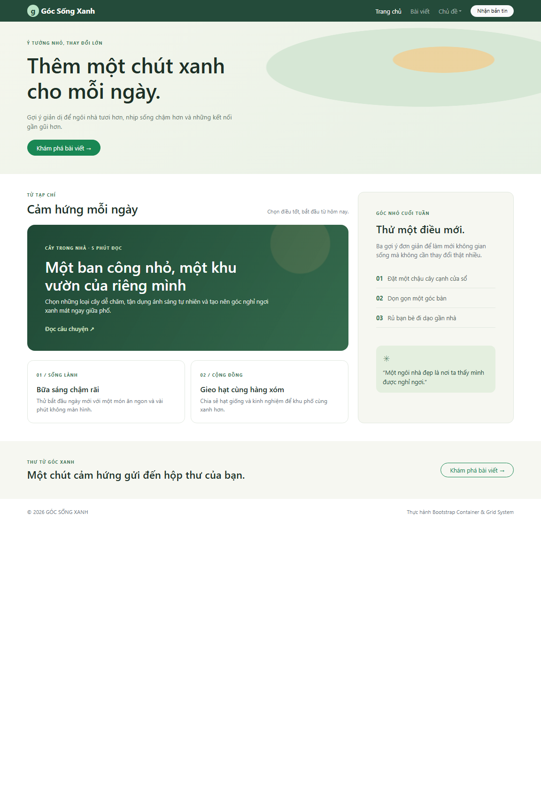

# Bootstrap Grid System

A responsive editorial page that practices Bootstrap containers, rows, columns, a responsive navbar, and a dropdown. The main article and sidebar use `col-12 col-lg-8` and `col-12 col-lg-4`; they stack below the `lg` breakpoint, with the sidebar below the main content.

## Run

Open `index.html` with an internet connection so Bootstrap 5.3.3 and its JavaScript bundle can load. On mobile, open the navbar and use the Topics dropdown.

## Screenshots

### Desktop

### Mobile

